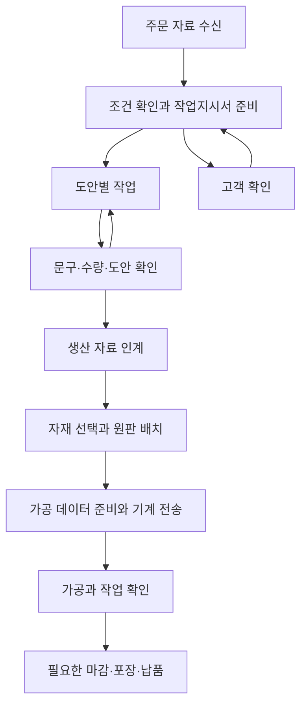

# 명판 제작의 현재 업무 흐름

문서 ID: BUS-WORKFLOW · 상태: 검토 중 · 작성일: 2026-11-21

## 1. 목적과 기록 범위

새 담당자가 주문 접수부터 도안·생산·후공정까지 누가 어떤 자료로 작업하고 무엇을 다음 담당자에게 넘기는지 파악하는 데 쓰는 문서다. 여러 업무 자료를 종합한 흐름이며, 현장 대조 항목은 [대표 업무 및 예외](scenarios.md)에서 확인한다. 장비 조작과 가공 조건은 현장 매뉴얼을 따른다.

**현재 확인한 CNC 음각 조각 방식** — Excel로 정리할 수 있는 대량 발주는 기존 R-edit로 DXF를 만든다. 도안 담당자가 Type Edit에서 도안을 마무리해 VND를 넘기면, 생산 담당자가 실제 판재에 맞춰 도안을 재배치하고 NC를 생성한다. 판재 재배치와 NC 생성은 현행 생산 업무이며 이번 개발 범위에서 제외한다.

- **자료 확인** — 원문에 기록된 업무 설명이다. 작성 시점 이후 달라졌을 수 있다.
- **과거 운영 기록** — 당시 현장 설명을 정리한 내용이다. 장비별 전송 경로나 후공정의 세부 방식은 현재 운영에 적용하기 전에 확인한다.
- **분석 초안** — 업무를 이해하기 위해 정리한 역할이나 결과물이다. 새 시스템의 역할과 절차는 별도로 검토한다.

## 2. 업무의 기본 단위

발주, 도안별 작업, 명판 항목, 생산 수량과 원판 배치의 뜻은 [명판 업무 기본 개념](nameplate-basics.md)에서 확인한다.

## 3. 전체 흐름

검수는 전체 흐름의 마지막 한 번으로 고정하지 않는다. 도안 확인, 가공 중 확인, 출고 확인의 대상과 책임이 다르다. 납품 후 최종검수의 실제 의미는 확인 항목으로 남긴다.

## 4. 단계별 현재 업무

### WF-01 주문 자료 수신과 내용 확인

- 입력: 메일·전화·팩스·문자·카카오톡 등으로 받은 발주 내용과 사진·Excel·CAD 등의 첨부 자료.
- 수행: 도안 담당자가 문구·규격·홀·재질·색상·가공 방식·수량 등 제작에 필요한 조건을 해석하고 부족한 조건은 고객에게 확인한다.
- 결과: 작업에 사용할 발주 원본과 확인된 제작 조건.
- 주의: 모든 주문이 정형 Excel로 도착하지 않는다. 문자로 입력한 내용과 고객 원본을 구분한다.
- 확인 수준: 자료 확인. S01, S03 3절.

### WF-02 작업지시서 준비와 분배

- 수행: 발주 확인 후 작업지시서를 먼저 작성·분배하고 파일 목록은 도안 작업 중 채운다.
- 기록된 지시서 정보: 고객, 필요한 프로젝트 구분, 발주일·납기·수령 방법, 파일 목록과 참고사항. 서로 다른 작업 종류가 한 건에 섞일 수 있다.
- 후공정에서는 인쇄된 지시서를 주로 사용한다는 기록이 있다. 전 직원의 상시 PC 상태 입력을 현재 업무로 가정하지 않는다.
- 결과: 도안 작업자가 함께 참조하는 작업지시서와 발주 원본 내용, 추후 연결할 도안 목록.
- 확인 수준: 자료 확인. S03 2·3·8절. 실제 양식의 필수값과 전달 시점은 변경 여부를 확인한다.

### WF-03 도안 분류와 기존 자료 찾기

- 수행: 반복 발주는 동일한 과거 작업물을 먼저 찾는다. 없으면 저장해 둔 기존 도안을 찾는다. 자주 들어오는 발주의 도안은 VND 파일로 따로 보관한다. 해당 도안도 없으면 가장 비슷한 도안을 참고하거나 새로 만든다. 이 순서는 현행 업무를 설명한다.
- 비교할 정보: 외형 치수뿐 아니라 홀 위치·개수, 텍스트 영역, 폰트·자폭·줄바꿈, 고객·프로젝트 조건.
- 현재 문제: 고객 조건이 개인 기억과 메모에 남아 있고, 반복 주문·교체품이 과거 제품과 다르게 만들어질 수 있다.
- 파일 하나에 여러 도안이 들어갈 수 있다. VND 파일명의 대표 크기를 내부 모든 명판의 규격으로 해석하지 않는다.
- 확인 수준: 자료 확인. S03 1·3·10절.

### WF-04 문구 준비와 기존 R-edit 사용

- 대량 발주 내용을 Excel로 정리할 수 있으면 기존 R-edit에 입력하여 DXF를 만든다.
- 그 외에는 발주서를 보며 복사·붙여넣기 또는 직접 타이핑하여 도안을 작성한다. 모든 소량 작업에 Excel 파일이 필요한 것은 아니다.
- Excel의 한 행은 명판 항목, 열은 본문·번호·전압 등 문구 공간에 대응한다.
- 기존 R-edit는 글자 객체에 문구를 채우고 명판 도안을 격자로 배치한다. 줄바꿈은 자동으로 처리하지 않으며 작업자가 줄바꿈과 글자 폭 등을 마저 조정한다.
- 과거 기록상 수량 기능이 없어 행 복사 또는 Type Edit에서 복제하는 방식을 혼용했다. 현재 버전에서 달라졌는지는 기존 프로그램 확인으로 판별한다.
- 확인 수준: 자료 확인. S03 3절, S05.

### WF-05 도안 조정과 문구 검토

- 수행: 긴 문구의 줄바꿈·자폭, 폰트·크기, 홀이나 테두리와의 간섭, 반복 제품 간 일관성을 확인한다.
- 원문 원칙: 문자·기호·띄어쓰기·대소문자를 자동으로 고치거나 누락하지 않는다. 오타 의심은 고객 확인 대상으로 구분한다.
- 레이아웃 조건: 실제 텍스트 영역, 줄 수, 고객 기준에 맞춘다. 특정 명판의 3줄·4.5mm 등을 전체 기본값으로 적용하지 않는다.
- 문구 검토 가이드는 개행 제안과 원문 수정의 구분을 규정한다. 그 가이드의 ‘매 요청 재질문’이라는 대화 방식까지 제품 UX 요구로 전용하지 않는다.
- 확인 수준: 자료 확인. S02, S03 5~7절.

### WF-06 Type Edit에서 마무리하고 생산에 인계

- 작업자는 기존 R-edit가 만든 DXF를 Type Edit의 불러오기 기능으로 열어 도안을 마무리한다.
- 도안 작업물은 생산 공정에 맞는 작업 파일이다. CNC 음각 조각에서는 마무리한 Type Edit VND를 생산 담당자에게 넘긴다.
- 정상 흐름은 발주의 도안을 모두 끝낸 뒤 생산으로 넘긴다. 급한 일부 선행 생산은 드문 예외로 수동 처리한다는 기록이 있다.
- 인계 정보는 도안 파일과 작업지시서가 중심이다. 원본 발주서까지 매번 포함하는지, 필수 파일 조합은 사례별 확인이 필요하다.
- 과거 기록상 생산자는 작업 시작 시 작업방 파일을 고객사 폴더로 옮긴다. 이 이동을 생산 완료로 해석하면 안 된다.
- 확인 수준: 자료 확인/과거 운영 기록. S03 3·8·10절, S06.

### WF-07 자재 선택과 원판 배치

- 수행: 생산 담당자가 제작 수량과 크기에 맞춰 새 판 또는 잔여판을 선택하고 Type Edit에서 VND의 도안을 실제 가공할 판재에 다시 배치한다.
- 같은 종류·두께·색상은 합배치하는 운영 기록이 있다. 서로 다른 주문을 함께 놓으면 업체·프로젝트 구분이 필요하다.
- 원판 크기·원점·여백·간격을 작업 조건에 맞춰 설정한다.
- 805×605mm, 여백 20mm, 간격 5mm 등은 과거 PH 작업 사례다. 모든 자재·기계의 고정값으로 사용하지 않는다.
- 확인 수준: 과거 운영 기록. S06. 소프트웨어가 원판 배치를 자동 최적화해야 한다는 결정은 아니다.

### WF-08 가공 데이터 준비와 기계 전송

- 수행: 생산 담당자가 판재에 맞춰 배치한 도안으로 Type Edit에서 NC를 생성하고 대상 기계로 전송한다.
- 개발 범위: 판재 재배치와 NC 생성은 작업별 판재와 가공 조건에 대한 현장 판단이 필요한 생산 업무로, 이번 개발 범위에서 제외한다.
- 운영 기록에는 CNC G1/G2/G3 세 대가 있고, G1/G2에는 네트워크 폴더, G3에는 FTP 경로가 사용되었다.
- 프로그램 간 자료 인계와 PC→기계 전송은 다른 경계다. 후자의 성공을 실제 가공 완료로 처리하지 않는다.
- NC 파일명 규칙과 목적지, PC별 접근 권한은 현재 환경을 직접 확인하여 연동 명세에 기록한다. 과거 IP·경로를 새 배포 설정으로 복사하지 않는다.
- 확인 수준: 과거 운영 기록. S06·S07. 실제 연결 환경을 이번 검토에서 시험하지 않았다.

### WF-09 기계·자재 세팅과 가공 확인

- 수행: 생산자가 기계와 자재를 세팅하고 가공한다. 공구·깊이·이송 등은 재질·두께·가공 종류에 따른다.
- 내부를 먼저 처리하고 초기 작업을 정지·확인한 뒤 외곽 작업을 진행하는 현장 기준이 기록되어 있다.
- 가공 순서·시작점·진행 방향 개선과 NC 정렬 기능에 대한 별도 개발 이력이 있다. 운영에서 사용한 기능과 실험 중인 알고리즘을 코드 확인 없이 동일시하지 않는다.
- 확인 수준: 과거 운영 기록. S06·S07. 구체적 가공 지시로 적용하기 전 현장 매뉴얼을 확인한다.

### WF-10 마감과 중간 확인

- 제품 조건에 따라 도색·잉크 충진·세척·양면테이프 부착 등의 후가공이 있다.
- 모든 재질에 모든 후가공을 적용하지 않는다. 도면과 주문 조건이 적용 작업을 결정한다.
- 수행자와 완료 표시 방식, 불량 재작업이 도안 수정으로 돌아가는 경우는 현재 자료만으로 고정할 수 없다.
- 확인 수준: 회사 소개 원문 확인 S01. 세부 인계·예외는 확인 대상.

### WF-11 포장·납품·검수

- 업무 흐름에는 포장과 배달·납품, 검수가 포함된다.
- 과거 기록에는 업체·프로젝트·납기·배송 정보를 포장 표기에 활용하고, 직접 배송과 택배 업무를 구분하는 사례가 있다.
- 실제 제품 수량과 지시서의 수량을 대조하는 작업이 중요하다. 누가 어느 시점에 최종 확인하는지와 고객 인수검수와의 관계는 확인 대상이다.
- 확인 수준: S01·S07의 배경 기록. 상세 상태 관리가 첫 도입 범위라는 의미는 아니다.

## 5. 인계 경계와 필요한 정보의 분석 초안

아래는 기존 업무에서 추출한 검토용 목록이며 모든 필드의 입력을 직원에게 강제하는 설계가 아니다.

| 경계 | 다음 담당자가 필요로 하는 정보 | 현재 확인할 부분 |
| --- | --- | --- |
| 접수→도안 | 고객 원본, 고객·프로젝트, 문구, 규격·재질·수량, 납기와 특이 조건 | 접수·도안이 동일인인 경우와 양식 |
| 도안→생산 | 최종 도안, 지시서, 수량, 자재·두께·색상, 주의사항, 필요한 원본 | 생산 시작 판단, 최종본 표시, 긴급 부분 인계 |
| 생산→마감·포장 | 실물과 소속, 수량, 후가공 조건, 불량·재작업 여부 | 종이·트레이·파일 중 사용하는 수단 |
| 포장→납품 | 고객·프로젝트, 납품 수량, 수령 방식·목적지, 미완료·분납 정보 | 인수 확인과 예외 처리 |

현재 자체 서버 장애 독립성 요구는 공정 간 인계에 적용된다. 이 표를 바로 서버 상태 모델로 변환하지 말고 실제 완료 의미를 먼저 정한다.

## 6. 근거와 확인 수준

| 표기 | 자료와 확인 위치 |
| --- | --- |
| S01 | 리치원컴퍼니 회사 소개, 제작 방식·자재·후가공 |
| S02 | 명판 문구 검수 가이드(nameplate_text_review_guideline.md), 원문 보존·개행·의심 표시 |
| S03 | 리치원컴퍼니 업무소프트웨어 요구사항 정의서 v0.7(2026-10-03), 1~3·8·10절의 운영 설명 |
| S04 | 리치원 핵심요구사항 설계검토 v0.13(2026-10-11), 34절 업무 단위 |
| S05 | 기존 R-edit 운영 설명(2026-09-27) 요약. 현재 코드·바이너리 미확인 |
| S06 | 생산 업무 매뉴얼 관련 기록(2025-12-28) 요약. 자재·배치·생산 당시 운영 |
| S07 | 설비·전송·마감·포장 업무 기록 요약. 원문과 현재 환경 미확인 |

S05~S07은 과거 설명의 요약이다. 실제 연동이나 장비 설정의 기준은 현장 확인 후 별도 명세에 기록한다.
